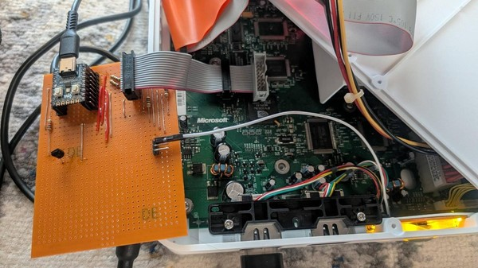
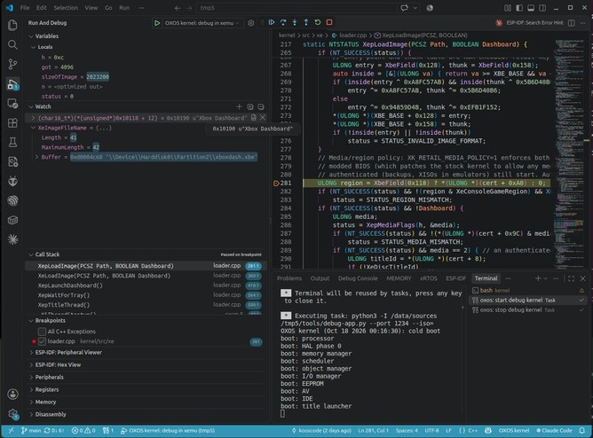

# OXOS — an open Xbox kernel

OXOS is an open-source replacement for the original Xbox's kernel and BIOS. It runs retail games and dashboards, in
[xemu](https://xemu.app) and on a real console, from a **fully open BIOS image**: no Microsoft code or boot-ROM
dump is needed to build or run it. The one key it carries, the retail certificate key, is there for interoperability:
saves and System Link work with stock consoles.

https://github.com/user-attachments/assets/cc898ea8-d569-4c9a-b313-9798c5ed72c6

*Vector Based OXOS Boot Animation*

## Highlights
- **Xbox 1.6 support:** the 1.6 console (Xcalibur encoder, MCPX revision D5) boots OXOS to the dashboard and runs
  games, from its own image (**`bios_1.6_vX.Y.Z_256k.bin`**) with OXOS's own 1.6 memory set-up and EEPROM pad
  calibration ([details](spec/oxos_internal/28_1_6_console.md)).
- **Complete kernel:** every function and variable of the retail kernel implemented ([clean-room](dmca_compliance.md)).
- **Open BIOS:** our own boot code from the first instruction; 1 MB and 256 KB images, and a 256 KB image for the 1.6.
- **Vector-based boot animation:** the OXOS vector based animation at boot (250% more free kernel space!)
- **Games from disc images** of your own discs (XISO, full dumps, CCI), mounted as the console's disc.
- **Big disks:** exFAT (format it on any PC, no size limits) and LBA48; FATX disks with extra F:/G: partitions.
- **In-game reset:** LT + RT + BACK + BLACK.
- **Title compatibility patching:** per-Title patches applied from `title_patches.ini`.
- **Game trainers:** XBMC4Gamers trainers (.etm, .xbtf) load and run as on a modded stock BIOS.
- **Saves and System Link with stock consoles:** titles get the same save-signature and System Link keys as on a
  stock console, so saves move between them and System Link games play together.
- **nxdk homebrew:** Fully supports nxdk's pbkit homebrew ([details](spec/oxos_internal/24_graphics_engine_init.md)).
- **TV output on every revision:** Conexant, Focus and Xcalibur encoders, composite to 1080i.
- **More memory for titles** than the stock kernel.
- **Developer tools:** serial boot log, kernel call tracing, network boot, source-level debugging in xemu.

## Try it
**In xemu** (nothing to build, no Microsoft files):
1. Install [xemu](https://xemu.app) and **[download the latest OXOS release](https://github.com/kooscode/oxos/releases/latest)**
   (`oxos_vX.Y.Z.zip`: the BIOS images and `title_patches.ini`) and unzip it.
2. In *Machine → Settings → System*, set *Flash (BIOS) File* to `bios_vX.Y.Z.bin` and leave *MCPX Boot ROM File*
   empty.
3. Use the free [xemu-dashboard](https://github.com/xemu-project/xemu-dashboard) disk (`xbox_hdd.qcow2`) or your own
   Xbox disk image as the hard disk, and start the machine.

**On a console:** flash the image for your console's revision to a modchip bank, and copy `title_patches.ini` to
`C:\OXOS\title_patches.ini` for the per-title fixes.

> **Xbox 1.6 hardware: use the `bios_1.6_…` image.** A 1.6 console sets up its memory differently, and the other
> images do not set it up correctly (it fails to boot or crashes). The `bios_1.6_…` image is only for the 1.6.

| Console | Image |
|---|---|
| 1.0 – 1.4 | `bios_vX.Y.Z_256k.bin` for a 256 KB bank (or `bios_vX.Y.Z.bin` for a 1 MB bank) |
| **1.6** | `bios_1.6_vX.Y.Z_256k.bin` for a 256 KB bank |

**1.6 with a Modxo (or any LPC rebuild):** keep the LPC wires short and use two grounds. Long wires corrupted the LPC
cycles on the test console and it showed FRAG (flashing red and green) even with other BIOSes
([wiring notes](tools/modxo/README.md#hardware)).

So far OXOS is tested on a 1.4 console, a second MCPX 1.1 console and a 1.6 console; reports from other revisions are
welcome in the [issues](https://github.com/kooscode/oxos/issues).

## Games and disks
- **exFAT disk:** format the disk as exFAT on a PC, as one partition or the whole disk. The Xbox drives are folders
  at its root: `/C` (dashboard), `/E` (saves and apps), `/F` (games), and so on.
  [Details](spec/oxos_internal/05_exfat_storage_spec.md).
- **Game folders:** [`tools/oxos_isonator`](tools/oxos_isonator) turns a disc image or an extracted game into a folder
  with the image and a launcher, which dashboards such as XBMC4Gamers list as the game itself.
  [Details](spec/oxos_internal/16_virtual_discs.md).
- **FATX disks** keep working, including the F: and G: partitions made by XBPartitioner or FATXplorer.
- **Trainers:** put .etm or .xbtf trainers in XBMC4Gamers' `system\trainers` folder (a de-duplicated set of 505,
  one per game, is in [`third_party/xbox_trainers`](third_party/xbox_trainers/README.md)), then pick a trainer and its
  cheats in the game's context menu (White button) before launching. OXOS starts every game with the same call as the
  stock kernel, which XBMC hooks to load the trainer; a unit test and a build check keep it that way.
  [Details](spec/oxos_internal/23_trainer_hook.md).

OXOS includes no games: make the images from discs you own.

## Hardware-in-the-loop testing


Real-console testing runs with nobody at the console. An RP2040 [Modxo](https://github.com/Shalx/Modxo) modchip on
the LPC header holds the BIOS and passes the kernel's serial log and POST codes to the PC; a transistor presses the
power button, and a capture card shows the screen. An AI coding agent (Claude Code) builds a kernel, network-boots
it, reads the log and the screen, and powers the console off, about a minute per run. How it works:
[`docs/hwitl.md`](docs/hwitl.md).

## For developers
OXOS builds on Linux with clang and lld; `make test` boots it in xemu and checks every milestone. Kernel and nxdk apps
can be debugged at source level in VS Code or gdb.



| Where | What |
|---|---|
| [`kernel/`](kernel/README.md) | setting up, building, testing and debugging; source layout, milestones, known deviations |
| [`spec/`](spec/README.md) | the behavioural specifications the kernel is written from |
| [`tools/`](tools/README.md) | host tools (BIOS packing, xemu runs, tracing, netboot, Modxo rig) and console apps (ISO launcher, title launcher, FTP server, oxos_isonator) |
| [`tests/`](tests/README.md) | the boot tests, the host unit tests and the test titles |
| [`docs/`](docs/) | the [C++ style guide](docs/cpp_style.md) and the [hardware-in-the-loop rig](docs/hwitl.md) |
| `third_party/` | what OXOS uses from others: Intel's CPU microcode and the trainer pack (in the repo); nxdk, XboxDev/cromwell and the xemu-dashboard disk (fetched by the build) |

The kernel's sources, grouped by what the code does (details in [`kernel/README.md`](kernel/README.md#layout)):

```
kernel/
  boot/            the open image's reset code, X-codes (Cromwell's for 1.0-1.5, OXOS's own for the 1.6) and 2BL
  include/xk/      every header: one per source folder (core.h, storage.h, ...) and a few for one part (hddfs.h, ...)
  src/
    arch/          assembly: entry, interrupt stubs, context switch, exceptions, quick reboot
    core/          processor, start-up, IRQL, DPCs, APCs, threads, scheduler, waits, timers, bug checks
    memory/        page tables, pool, title virtual memory
    objects/       object manager, and the events, mutants, semaphores and timers behind handles
    io/            I/O manager: devices, IRPs, files
    hardware/      chipset, SMBus/SMC, EEPROM, video encoder, network PHY, GPU set-up, in-game reset, serial port
    bootscreen/    the boot splash and jingle (boot-only code, freed before the first title)
    storage/       IDE channel, hard disk and its partition layout, DVD drive, virtual discs
    filesystems/   hddfs/ (FATX and exFAT), XDVDFS, UDF, RAW, the file-system cache, mount routing
    crypto/        SHA-1, HMAC, RC4, DES, RSA
    titles/        XBE loader and launcher, netboot titles, title patches, the call tracer
    runtime/       strings, sprintf, interlocked operations, critical sections, time
  selftest/        the boot self-tests (self-test build only)
  splash/          the boot logo (SVG)
  title_patches/   the per-title patch file
```

## Not yet
- One image for every revision: the 1.6 still needs its own image (a run-time 1.6 check in the X-codes is planned).
- Revisions 1.0 – 1.3 and 1.5 are untested.
- Debugging on a real console (a GDB stub over the serial port).

## Credits and license
OXOS is GPL-2.0 ([`LICENSE`](LICENSE)). It uses:
- [XboxDev/cromwell](https://github.com/XboxDev/cromwell) (GPL-2.0): the X-code table (and the layout of the 1.6
  console's own) and EEPROM key states.
- Intel's CPU microcode for the Pentium III, unmodified under Intel's licence ([`third_party/intel_ucode`](third_party/intel_ucode)).
- [xemu-dashboard](https://github.com/xemu-project/xemu-dashboard) (MIT): the default disk for the tests.
- [nxdk](https://github.com/XboxDev/nxdk): the console apps and test titles.

Full notices: [`THIRD_PARTY_NOTICES.md`](THIRD_PARTY_NOTICES.md).

## Legal
An independent project, not affiliated with or endorsed by Microsoft. "Xbox" is a trademark of Microsoft
Corporation. How OXOS was made, and the legal basis for it: [`dmca_compliance.md`](dmca_compliance.md).
