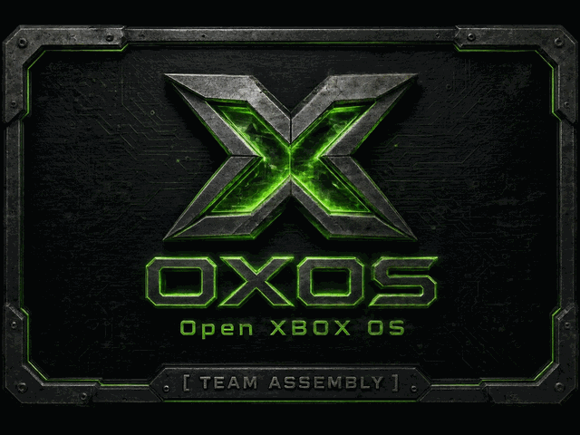
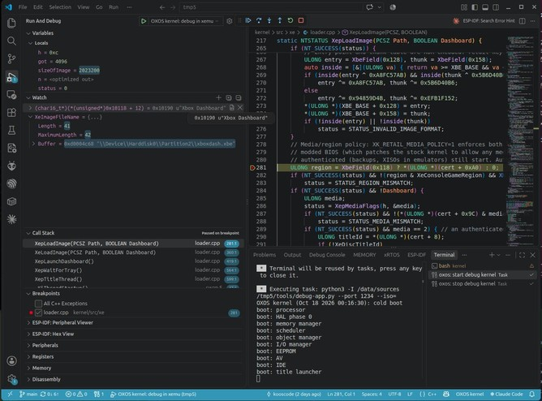

# OXOS — an open Xbox kernel

A clean-room, ABI-compatible reimplementation of the original Xbox kernel (`xboxkrnl.exe` 1.0.4627.1) in C++,
built on Linux with clang and lld, inside a **fully open 1 MB BIOS image**: no Microsoft code, keys or boot-ROM
dump is needed to build or run it. It boots retail software in [xemu](https://xemu.app); console revisions
1.0–1.5 are the target.

**Clean-room:** OXOS contains no Microsoft source code, machine code, disassembly or decompiled code. The retail
kernel was studied to write behavioural specifications, and the kernel is written from those specifications only.
The method and its legal basis are in [`dmca-compliance.md`](dmca-compliance.md).



*The OXOS boot splash, captured in xemu.*

**Status:**
- Every function and variable the 4627 kernel exports is implemented.
- In xemu it boots the dashboard, So far played **Halo**, **Halo 2**, **Brute Force**, **Half-Life 2** and **Enter The Matrix**
- The BIOS image is ours from the first instruction, and xemu runs it without an MCPX boot ROM file.
- **Boot chain:** our own 2BL on [Cromwell](https://github.com/XboxDev/cromwell)'s X-codes, with full glitch
  support (the X-code overflow trick): no Microsoft key or boot-ROM dump needed.
- **Memory:** titles start with slightly more free memory than on the stock kernel (in every title measured).
- **SuperIO serial support:** boot log, `DbgPrint` output and crash reports over the serial port.
- **Kernel call tracing:** a record of the kernel calls a title makes, saved automatically when it crashes.
- **Interactive source-level debugging** of the kernel and nxdk titles in xemu, with gdb or VS Code.
- **IDE LBA48 Support** allows large disks beyond 2TB (i.e NO size limit)
- **exFAT Support** for standard exFAT formatted disks, No file or disk size limit
- **TV output on every revision:** the Conexant (1.0–1.3), Focus (1.4–1.5) and Xcalibur (1.6) video encoders, in
  composite, S-video, SCART RGB and component (480i/576i, **480p, 720p, 1080i**, the signal HDMI adapters take).
- **Hardware testing TBD:** OXOS has not run on a real console yet.

## Running OXOS in xemu today !!
No building, no code and **no Microsoft files** - Just download the ready BIOS image and drop it into xemu!

Free, Legal and Open Source!!

1. Install [xemu](https://xemu.app).
2. **[Download the latest OXOS BIOS](https://github.com/kooscode/oxos/releases/latest)**, a 1 MB `bios_vX.Y.bin`.
3. In xemu, open *Machine → Settings → System*: set *Flash (BIOS) File* to the downloaded image and leave
   *MCPX Boot ROM File* empty.
4. Set the hard disk to the free [xemu-dashboard](https://github.com/xemu-project/xemu-dashboard) disk image
   (`xbox_hdd.qcow2` from its latest release; MIT-licensed, with an open dashboard), or your own Xbox disk image.
5. Start the machine: the OXOS splash fades in and the dashboard starts. Load your own game discs (XISO) from
   xemu's *Machine* menu.

OXOS has only been tested in xemu so far, not on a real console.

## Getting Started (Kernel Developer)
To build OXOS yourself, change it, run its tests or debug the kernel and your own nxdk titles.

### How it was made
- **The kernel** (`kernel/src`): the reference kernel was studied with Ghidra to write behavioural specifications
  (`spec/stock/`), and the kernel is written from those specs only. No Microsoft source code, machine code,
  disassembly, decompiled code or keys are included. The one kind of data taken from Microsoft images is the video
  encoder register tables, recorded as plain register maps in `spec/stock/18`–`20` (functional hardware constants;
  [`dmca-compliance.md`](dmca-compliance.md) §3).
- **Planned features** (`spec/cerbios/`): the Cerbios BIOS's kernel and extension were studied the same way, and its
  features (128 MB, large disks, a second hard disk, virtual discs, IGR and more) were written up as behavioural
  specs for later OXOS work.
- **The boot chain** (`kernel/boot`, spec 01 §5):
  - our own reset code and 2BL;
  - the hardware set-up table (X-codes) and the EEPROM key handling of
    [XboxDev/cromwell](https://github.com/XboxDev/cromwell) (GPL-2.0), which the build fetches.

  On a console the MCPX boot ROM runs Cromwell's X-codes, whose "overflow trick" hands control to our 2BL without
  any Microsoft key. Without a boot ROM (xemu), our reset code runs the same X-codes. The hard disk unlocks with
  Cromwell's EEPROM key states, as Cromwell has done for twenty years.

### Setting up
Tested on Ubuntu 24.04 with clang/lld 18, Python 3.12 and xemu 0.8.136; other Linux distributions work with the
same packages under their own names.

**1. Install the build tools.**
```
sudo apt install git make clang lld llvm
```
(`clang` and `lld` build the kernel, `llvm` provides `llvm-objcopy`; the build scripts use the Python 3 that comes
with Ubuntu.)

**2. Install xemu.** Download the AppImage from [xemu.app](https://xemu.app) (0.8.136 tested) and put it at
`~/.local/bin/xemu` (or anywhere on `PATH` as `xemu`):
```
mkdir -p ~/.local/bin
mv ~/Downloads/xemu-*-x86_64.AppImage ~/.local/bin/xemu && chmod +x ~/.local/bin/xemu
sudo apt install libfuse2t64     # AppImages need FUSE 2 on Ubuntu 24.04
```

**3. Clone the repository.**
```
git clone https://github.com/kooscode/oxos.git
cd oxos
```
Nothing else needs fetching by hand. On first use the build fetches into `third_party/`, each at a pinned version
(so the first build needs internet access):
- [XboxDev/cromwell](https://github.com/XboxDev/cromwell) (its X-code table and EEPROM key states), by `make bios`;
- the [xemu-dashboard](https://github.com/xemu-project/xemu-dashboard) hard-disk image (MIT-licensed, an open
  dashboard on a formatted drive), checked by SHA-256, by `make test` and `make run`: the default hard disk;
- [nxdk](https://github.com/XboxDev/nxdk), by the controller test.

**4. Optionally, add games and your own files.**
- Your game discs (XISO) go in `xiso/`.
- `xbox-files/` holds your own copyrighted files, which are never committed: for example a disk with the stock
  Microsoft dashboard (its Settings set video modes, clock and language) as `xbox-files/hdd/msdash.qcow2`,
  which `make run` then prefers over the default disk.

**No BIOS, no MCPX boot ROM and no hard-disk image are needed.** `xbox-files/`, `xiso/` and `xemu-state/` (below)
are git-ignored.

**5. Build and boot.**
```
cd kernel
make bios      # kernel/build/selftest/bios.bin, the open BIOS image
make test      # boots it in xemu and checks every milestone (a few minutes; xemu windows open and close)
make run       # an interactive xemu window: the dashboard, or a game with ISO=../xiso/game.iso
```

**Optional extras:**
- **Controller test** (`make test-controller`): `sudo apt install cmake flex bison`, and write access to `/dev/uinput`
  (e.g. a udev rule, or `sudo setfacl -m u:$USER:rw /dev/uinput` for the current session).
- **Debugging with gdb or VS Code** (see below): `sudo apt install gdb-multiarch binutils`; for nxdk apps also an
  nxdk checkout (`make -C kernel nxdk` fetches one into `third_party/nxdk`).
- **Your own boot splash:** `make bios SPLASH=my-picture.jpg` converts any picture with Pillow
  (`sudo apt install python3-pil`); the committed `kernel/splash/splash.png` is already converted and needs nothing.
- **Comparing with the original:** your own BIOS dump in `xbox-files/bios/` and the MCPX boot ROM (`STOCK_MCPX`, or
  `MCPX_ROM=...` to boot OXOS through the real ROM as a console does) for `make run-stock` and `make test-mcpx`.

## Build and run
```
cd kernel
make bios                        # build/selftest/bios.bin, the open BIOS image
make test                        # boot it in xemu and check every milestone
make run ISO=../xiso/game.iso    # play: the release BIOS in an interactive xemu window
make test-mcpx MCPX_ROM=...      # optional: the dashboard again, through a real MCPX boot ROM
make run-stock ISO=...           # optional: your original BIOS, for comparison
make run-trace-basic ISO=...     # optional: a trace build, for troubleshooting (debug serial output)
make run-trace-full ISO=...      # optional: also records the title's last kernel calls, dumped on a crash and on exit
make print-trace-dump            # optional: print those calls at any time, from a second terminal (LAST=, ONLY=, ALL=1)
make run-gdb ISO=...             # optional: the debug kernel, paused for gdb (see "Debugging" below)
```
`make run` starts from `xbox-files/hdd/msdash.qcow2` when you have it (a hard disk with the stock Microsoft
dashboard, whose Settings set up video modes, clock and language), otherwise from the default xemu-dashboard disk;
pick another with `PLAY_HDD=...` (the tests use `HDD_IMAGE`, the xemu-dashboard disk unless set). It keeps its
hard-disk copy and EEPROM in `xemu-state/oxos-<instance>/`: `oxos-msdash`, `oxos-xemu` for the default disk, or
`INSTANCE=name` for any other. Saves and settings survive between runs (`FRESH=1` starts over from the image, which is never written; `make run-stock` uses
`xemu-state/stock-<instance>/`).
It starts with the EEPROM's widescreen flag set, in a 1920x1080 window at twice the render resolution; games that
support widescreen show 16:9 and the others 4:3 (xemu follows the widescreen signal each game sends). Change that
with `WIDE=0`, `ASPECT=16x9` (force xemu's aspect: auto, native, 4x3, 16x9), `SIZE=1280x960`, `SCALE=3` or `FULL=1`
(full screen). With HD modes enabled in the dashboard, games run in 480p, 720p or 1080i (spec 17): 720p and 1080i
always show at 16:9, while 480p follows the game's own widescreen signal as on the original kernel, so a widescreen
game that leaves it off in 480p (such as Halo 2) shows 4:3 under `auto`; run it with `ASPECT=16x9`
(`make run ISO=../xiso/halo2-xiso.iso ASPECT=16x9`). Enter the Matrix in 720p or 1080i crashes xemu at render scale
2 or more (an xemu limitation); use `SCALE=1` or turn those modes off in the dashboard.

`make test-controller` needs the extras listed under "Getting Started (Kernel Developer)"; it fetches
[nxdk](https://github.com/XboxDev/nxdk) into `third_party/`.

See [`tools/README.md`](tools/README.md) for the host tools behind these targets, [`tests/README.md`](tests/README.md) for what each test checks, [`kernel/README.md`](kernel/README.md) for the layout, milestones and known deviations, and [`spec/README.md`](spec/README.md) for the
behavioural specifications.

## Debugging with gdb or VS Code
xemu's GDB server and a debug build of the kernel (`DEBUG=1`: DWARF debug info, `-Og`) let you debug at source
level: breakpoints, stepping, variables and the call stack, in your own [nxdk](https://github.com/XboxDev/nxdk)
apps and in the kernel, in one session (step from your app into a kernel call and back). You need `gdb-multiarch`
(Ubuntu: `sudo apt install gdb-multiarch`) and GNU `objcopy` (binutils).

**The kernel in VS Code:** open the OXOS folder itself (its `.vscode/` is set up), set a breakpoint in kernel
source and press F5. It asks for a disc image (leave it empty for the dashboard), builds the debug kernel, starts
xemu paused and runs to your breakpoint. For example, line 281 of `kernel/src/xe/loader.cpp` (in `XepLoadImage`)
stops on every title load; the watch `(char16_t*)(*(unsigned*)0x10118 + 12)` shows the title's name and
`XeImageFileName` its path.



*Kernel debugging in VS Code: the OXOS kernel stopped at a breakpoint in `XepLoadImage` while loading the dashboard,
with its call stack, locals, the title's name and path in watches, and the kernel's boot log in the terminal.*

**An nxdk app in VS Code** (C/C++ extension, `ms-vscode.cpptools`):
1. Copy `tools/vscode/*.json` into your app's `.vscode/` folder and set `oxos.dir` and `oxos.nxdkDir` in
   `settings.json`.
2. Set breakpoints and press F5. VS Code builds the app with `make DEBUG=y`, then `tools/debug-app.py` builds the
   debug kernel (once), packs the app's `bin/` folder as a disc, and starts xemu paused with the kernel's serial log in
   the terminal. VS Code attaches, the kernel boots the disc, and the app stops at your first breakpoint. Stopping the
   debugger closes xemu. Kernel source is loaded too, so you can step from the app into kernel calls.
3. Add `.oxos/` (the disc image and gdb symbol file the launcher writes) to your app's `.gitignore`.

**From a terminal:** `make -C kernel run-gdb` starts the debug kernel paused (add `ISO=...` for a disc); attach with
`gdb-multiarch kernel/build/debug/xboxkrnl.elf -ex 'target remote localhost:1234'`, set breakpoints and `continue`.
For an nxdk app, `python3 tools/debug-app.py path/to/app` does the app steps above; then attach with
`gdb-multiarch path/to/app/.oxos/main.elf -ex 'set confirm off' -ex 'add-symbol-file kernel/build/debug/xboxkrnl.elf'
-ex 'target remote localhost:1234'`.

Notes: gdb sees one CPU, not the app's threads; timers stop while you are paused. C++ apps should add
`CXXFLAGS += -mllvm -dwarf-linkage-names=Abstract` to their Makefile, so that gdb shows function names (it cannot
read the MSVC-style names nxdk's compiler uses). Debugging on a real Xbox (a GDB stub in the kernel, over the SuperIO
serial port) is not implemented yet.

## About the BIOS image you build
`make bios` contains our code plus parts of XboxDev/cromwell (X-codes and the EEPROM key states), both GPL-2.0;
there is nothing of Microsoft's in it. One known gap: there is no certificate key. Games therefore derive
different save-signature and System Link keys than a stock console does: saves made on a stock console do not
verify under OXOS, and System Link with stock consoles does not work. Saves made under OXOS work among themselves.

`IMAGE=base` still packs the kernel into your own Microsoft BIOS instead, for comparisons. Such an image contains
Microsoft's 2BL and keys: do not distribute that one.

## Next steps
- **Real hardware (TBD):** testing on real consoles, video output first (all three encoders, component HD via HDMI
  adapters), then the rest of the hardware (the open image's 1.6 values, `MCPX16=1`, are untested).
- **Certificate key:** a bring-your-own-key option for stock-compatible saves and System Link.
- **Debugging on real hardware:** a GDB stub in the kernel over the SuperIO serial port, with the debugger-only
  exports, so the same gdb and VS Code debugging works on a console.

## License
GPL-2.0 (see [`LICENSE`](LICENSE)). The build fetches [XboxDev/cromwell](https://github.com/XboxDev/cromwell)
(GPL-2.0) for the X-codes and EEPROM key states, and the
[xemu-dashboard](https://github.com/xemu-project/xemu-dashboard) hard-disk image (MIT, with its components' licenses
in `third_party/xemu-dashboard/LICENSE`) as the default disk; `tests/controller-test-title` builds against
[nxdk](https://github.com/XboxDev/nxdk). All keep their own licenses and copyrights; none of them is committed here.

## Legal
This is an independent project, not affiliated with or endorsed by Microsoft. "Xbox" is a trademark of
Microsoft Corporation. Use it with game discs you own.
How OXOS was developed, and the legal basis for it, is documented in [`dmca-compliance.md`](dmca-compliance.md).
