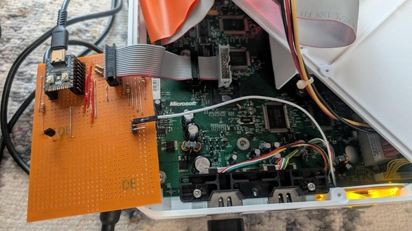

# OXOS — an open Xbox kernel

OXOS is an open-source replacement for the original Xbox's kernel and BIOS. It runs retail games and dashboards, in
[xemu](https://xemu.app) and on a real console, from a **fully open BIOS image**: no Microsoft code, keys or
boot-ROM dump is needed to build or run it.

https://github.com/user-attachments/assets/bffc85c4-109c-4fdb-a597-2168cf89328b

*A real 1.4 Xbox powering on with OXOS: the OXOS splash and boot jingle, then Brute Force from a disc image on a
PC-formatted exFAT SSD (sound on).*

## Highlights
- **Complete kernel:** every function and variable of the retail 4627 kernel, written in C++20 from behavioural
  specifications ([clean-room](dmca-compliance.md)).
- **Open BIOS:** our own boot code from the first instruction; 1 MB and 256 KB images.
- **Games from disc images** of your own discs (XISO, full dumps, CCI), mounted as the console's disc.
- **Big disks:** exFAT (format it on any PC, no size limits) and LBA48; FATX disks with extra F:/G: partitions.
- **In-game reset:** LT + RT + BACK + BLACK.
- **Game trainers:** XBMC4Gamers trainers (.etm, .xbtf) load and run as on a modded stock BIOS.
- **TV output on every revision:** Conexant, Focus and Xcalibur encoders, composite to 1080i.
- **More memory for titles** than the stock kernel.
- **Developer tools:** serial boot log, kernel call tracing, network boot, source-level debugging in xemu.

## Try it
**In xemu** (nothing to build, no Microsoft files):
1. Install [xemu](https://xemu.app) and **[download the latest OXOS release](https://github.com/kooscode/oxos/releases/latest)**.
2. In *Machine → Settings → System*, set *Flash (BIOS) File* to `bios_vX.Y.Z.bin` and leave *MCPX Boot ROM File*
   empty.
3. Use the free [xemu-dashboard](https://github.com/xemu-project/xemu-dashboard) disk (`xbox_hdd.qcow2`) or your own
   Xbox disk image as the hard disk, and start the machine.

**On a console:** flash `bios_vX.Y.Z_256k.bin` to a 256 KB modchip bank (or the 1 MB image to a 1 MB bank). So far
OXOS is tested on one 1.4 console; reports from other revisions are welcome in the
[issues](https://github.com/kooscode/oxos/issues).

## Games and disks
- **exFAT disk:** format the disk as exFAT on a PC, as one partition or the whole disk. The Xbox drives are folders
  at its root: `/C` (dashboard), `/E` (saves and apps), `/F` (games), and so on.
  [Details](spec/oxos-internal/05-exfat-storage-spec.md).
- **Game folders:** [`tools/oxos-isonator`](tools/oxos-isonator) turns a disc image or an extracted game into a folder
  with the image and a launcher, which dashboards such as XBMC4Gamers list as the game itself.
  [Details](spec/oxos-internal/16-virtual-discs.md).
- **FATX disks** keep working, including the F: and G: partitions made by XBPartitioner or FATXplorer.
- **Trainers:** put .etm or .xbtf trainers in XBMC4Gamers' `system\trainers` folder, then pick a trainer and its
  cheats in the game's context menu (White button) before launching. OXOS starts every game with the same call as the
  stock kernel, which XBMC hooks to load the trainer; a unit test and a build check keep it that way.
  [Details](spec/oxos-internal/23-trainer-hook.md).

OXOS includes no games: make the images from discs you own.

## Hardware-in-the-loop testing

Real-console testing runs with nobody at the console. An RP2040 [Modxo](https://github.com/Shalx/Modxo) modchip on
the LPC header holds the BIOS and passes the kernel's serial log and POST codes to the PC; a transistor presses the
power button, and a capture card shows the screen. An AI coding agent (Claude Code) builds a kernel, network-boots
it, reads the log and the screen, and powers the console off, about a minute per run. How it works:
[`docs/hwitl.md`](docs/hwitl.md).

## For developers
OXOS builds on Linux with clang and lld; `make test` boots it in xemu and checks every milestone. Kernel and nxdk apps
can be debugged at source level in VS Code or gdb.

| Where | What |
|---|---|
| [`kernel/`](kernel/README.md) | setting up, building, testing and debugging; source layout, milestones, known deviations |
| [`spec/`](spec/README.md) | the behavioural specifications the kernel is written from |
| [`tools/`](tools/README.md) | host tools (BIOS packing, xemu runs, tracing, netboot, Modxo rig) and console apps (ISO launcher, title launcher, FTP server, oxos-isonator) |
| [`tests/`](tests/README.md) | the boot tests and test titles |

## Not yet
- Console revisions other than 1.4 are untested; the 1.6 pad calibration is not implemented.
- No certificate key: saves made on a stock console do not verify, and there is no System Link with stock consoles.
- Debugging on a real console (a GDB stub over the serial port).

## Credits and license
OXOS is GPL-2.0 ([`LICENSE`](LICENSE)). It uses:
- [XboxDev/cromwell](https://github.com/XboxDev/cromwell) (GPL-2.0): the X-code table and EEPROM key states.
- Intel's CPU microcode for the Pentium III, unmodified under Intel's licence ([`third_party/intel-ucode`](third_party/intel-ucode)).
- [xemu-dashboard](https://github.com/xemu-project/xemu-dashboard) (MIT): the default disk for the tests.
- [nxdk](https://github.com/XboxDev/nxdk): the console apps and test titles.

Full notices: [`THIRD_PARTY_NOTICES.md`](THIRD_PARTY_NOTICES.md).

## Legal
An independent project, not affiliated with or endorsed by Microsoft. "Xbox" is a trademark of Microsoft
Corporation. How OXOS was made, and the legal basis for it: [`dmca-compliance.md`](dmca-compliance.md).
