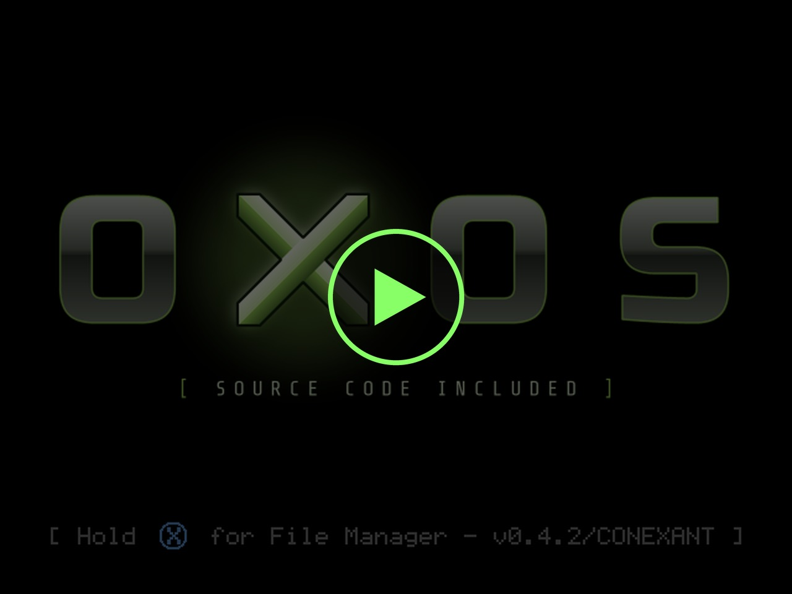
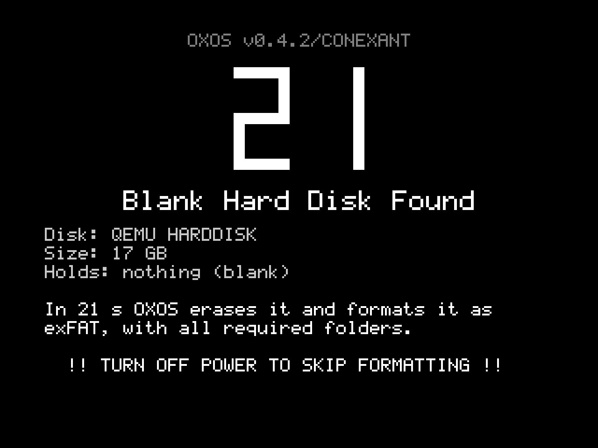
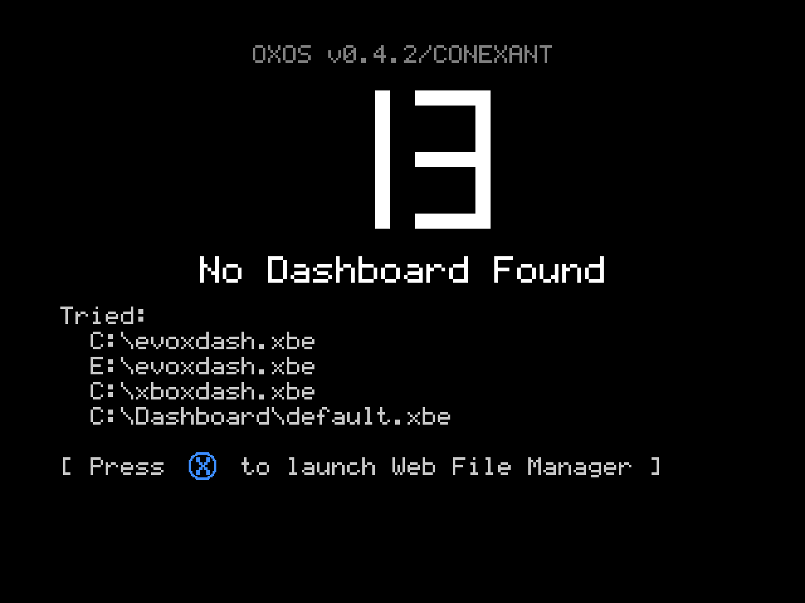
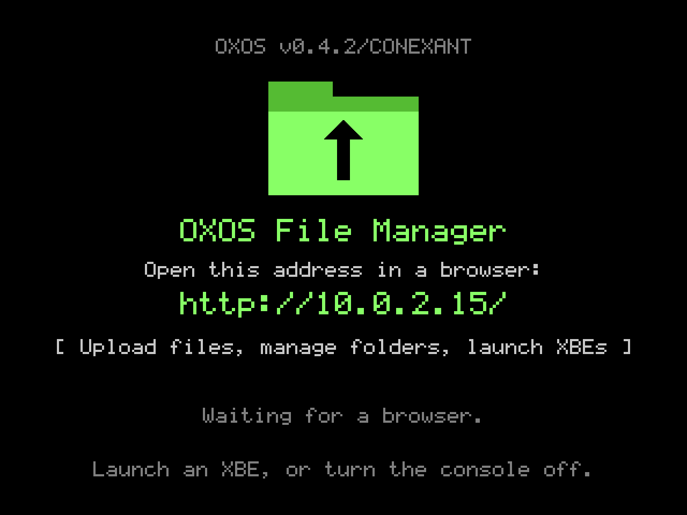
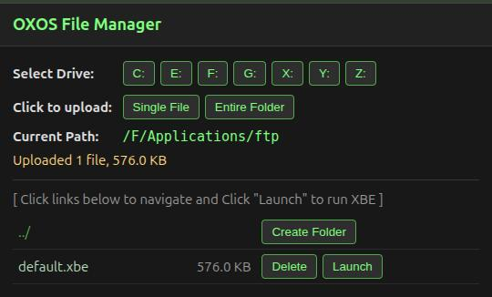

# OXOS — an open Xbox kernel

OXOS is an open-source replacement for the original Xbox's kernel and BIOS. It runs retail games and dashboards in
[xemu](https://xemu.app) and on real consoles, from a **fully open BIOS image**: no Microsoft code or boot-ROM dump is
needed to build or run it.

*From Blank Disk to XB Live Dashboard in seconds!! (click to play)*

## Highlights
- **Every console revision, 1.0 to 1.6:** Conexant, Focus and Xcalibur video encoders, composite to 1080i.
- **Complete kernel:** Every function and variable of the retail kernel, written [clean-room](dmca_compliance.md).
- **Open Source BIOS:** Original code from first instruction at boot to launching and running any XBOX Title.
- **Big disks:** exFAT (no size limits) and LBA48; FATX disks with extra F:/G: partitions keep working.
- **Blank disk to dashboard without a PC:** New disks are formatted as exFAT at boot; press the X button for the
  [OXOS File Manager](#oxos-file-manager) to upload files and launch XBEs from any browser.
- **Games from disc images:** of your own discs (XISO, full dumps, CCI).
- **Trainers, title patches:** Supports trainers, and patches any title from an .ini file!
- **Launch redirects:** `C:\OXOS\launch_redirect.ini` starts another XBE in place of one a title launches, e.g. a
  new Xbox Live updater instead of the old one ([how to use it](docs/launch_redirect.md)).
- **In-Game Reset (IGR):** the standard In Game Reset we are used to (LT + RT + BACK + BLACK).
- **Saves / System Link / XBOX Live:** OXOS is fully compatible with stock consoles and XB Live / Insignia.
- **Error screens that explain themselves:** what happened and what to try, instead of a bare number; a kernel
  crash shows its code and parameters for a bug report.
- **nxdk homebrew:** fully supports the latest nxdk homebrew.

## Try it
Download the [latest release](https://github.com/kooscode/oxos/releases/latest) (`oxos_vX.Y.Z.zip`) and unzip it.

**xemu:** in *Machine → Settings → System*, set *Flash (BIOS) File* to `bios_vX.Y.Z.bin` and leave *MCPX Boot ROM
File* empty. Use the free [xemu-dashboard](https://github.com/xemu-project/xemu-dashboard) disk or your own disk
image.

**Console:** flash the image for your revision to a modchip bank. Copy `title_patches.ini` to `C:\OXOS\` for the
per-title fixes.

| Console | Image |
|---|---|
| 1.0 – 1.4 | `bios_vX.Y.Z_256k.bin` (256 KB bank) or `bios_vX.Y.Z.bin` (1 MB bank) |
| **1.6** | `bios_1.6_vX.Y.Z_256k.bin` (256 KB bank): **only** this image works on a 1.6 |

Tested on a 1.4 (Focus), an MCPX 1.1 console, a 1.6 (Xcalibur) and a Conexant debug kit. Reports from other
revisions are welcome in the [issues](https://github.com/kooscode/oxos/issues). On a 1.6 with a Modxo, keep the LPC
wires short ([wiring notes](tools/modxo/README.md#hardware)).

## OXOS File Manager
<table>
<tr>
<td width="50%"></td>
<td width="50%"></td>
</tr>
<tr>
<td align="center"><em>1. A blank disk is formatted as exFAT</em></td>
<td align="center"><em>2. No dashboard yet: press X</em></td>
</tr>
<tr>
<td width="50%"></td>
<td width="50%"></td>
</tr>
<tr>
<td align="center"><em>3. The File Manager on the Xbox</em></td>
<td align="center"><em>4. The File Manager in the browser</em></td>
</tr>
</table>

Press **X** on a controller while the boot logo and jingle play, or on the "No Dashboard Found" screen: OXOS
shows a web address. Open it in any browser on the same network to:
- browse the drives;
- upload single files or whole folders (a complete dashboard in one go, about 11 MB/s);
- create folders, rename files and folders, and delete files and empty folders;
- launch any `.xbe`.

It is built into the kernel and its memory is freed when a title starts, so games lose nothing. There is no log-in:
anyone on the local network can use it while it is on screen.
[Details](spec/oxos_internal/32_file_manager_button.md).

## Games and disks
- **exFAT:** format the disk as exFAT on a PC, or let OXOS do it: a blank or non-Xbox disk is formatted at boot after
  a 30 s countdown (turn the console off to keep it). The drives are folders at the disk's root: `/C`, `/E`, `/F`, ...
  ([details](spec/oxos_internal/30_disk_format.md)).
- **Game folders:** [`tools/oxos_isonator`](tools/oxos_isonator) turns a disc image into a folder that dashboards such
  as XBMC4Gamers list as the game itself.
- **Trainers:** XBMC4Gamers trainers (.etm, .xbtf) work as on a modded stock BIOS; a pack is in
  [`third_party/xbox_trainers`](third_party/xbox_trainers/README.md).

OXOS includes no games: make the images from discs you own.

## Developers
Building, testing, debugging and the source layout: [`kernel/README.md`](kernel/README.md). Specifications:
[`spec/`](spec/README.md). Real-console testing runs unattended on a
[hardware-in-the-loop rig](docs/hwitl.md).

## Not yet
- One image for every revision (the 1.6 still needs its own).
- Retail 1.0 – 1.3 consoles are untested (the Conexant encoder is tested on a 1.0 debug kit).
- Debugging on a real console.

## Credits and license
OXOS is GPL-2.0 ([`LICENSE`](LICENSE)). It uses [XboxDev/cromwell](https://github.com/XboxDev/cromwell) (GPL-2.0),
Intel's Pentium III microcode, [xemu-dashboard](https://github.com/xemu-project/xemu-dashboard) (MIT), and for its
console apps [nxdk](https://github.com/XboxDev/nxdk) with [SDL3](https://www.libsdl.org) (zlib) through Ryzee119's
[nxdk-sdl3](https://github.com/Ryzee119/nxdk-sdl3) (MIT). Full notices:
[`THIRD_PARTY_NOTICES.md`](THIRD_PARTY_NOTICES.md).

## Legal
An independent project, not affiliated with or endorsed by Microsoft. "Xbox" is a trademark of Microsoft
Corporation. How OXOS was made, and the legal basis for it: [`dmca_compliance.md`](dmca_compliance.md).
