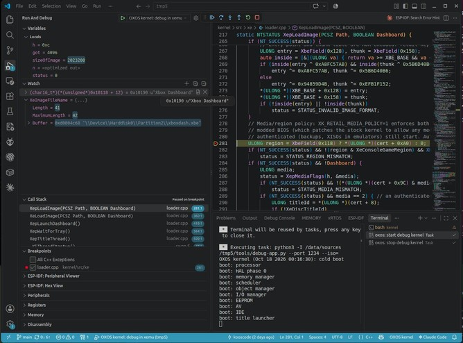

# Open Xbox kernel

A clean-room C++ reimplementation of the original Xbox kernel (`xboxkrnl.exe`), ABI-compatible with
retail 1.0.4627.1. It is built from the behavioural specs in `../spec/stock/` (clean-room: no Microsoft source code,
machine code, disassembly or decompiled code is used; the video encoder and NV2A pad calibration tables are the one
data taken from Microsoft images, see [`../dmca_compliance.md`](../dmca_compliance.md)). Targets console revisions 1.0–1.5; on
1.6 the Xcalibur video encoder is driven, the rest of 1.6 is untested. It builds on Linux with clang + lld-link.

## Setting up
Tested on Ubuntu 24.04 with clang/lld 18, Python 3.12 and xemu 0.8.136; other Linux distributions work with the
same packages under their own names.

1. **Build tools:** `sudo apt install git make clang lld llvm` (`llvm` provides `llvm-objcopy`; the build scripts use
   the Python 3 that comes with Ubuntu).
2. **xemu:** download the AppImage from [xemu.app](https://xemu.app) and put it at `~/.local/bin/xemu` (or anywhere
   on `PATH` as `xemu`):
   ```
   mkdir -p ~/.local/bin
   mv ~/Downloads/xemu-*-x86_64.AppImage ~/.local/bin/xemu && chmod +x ~/.local/bin/xemu
   sudo apt install libfuse2t64     # AppImages need FUSE 2 on Ubuntu 24.04
   ```
3. **The repository:** `git clone https://github.com/kooscode/oxos.git`. Nothing else needs fetching by hand: on
   first use the build fetches into `../third_party/`, each at a pinned version (so the first build needs internet
   access): [XboxDev/cromwell](https://github.com/XboxDev/cromwell) by `make bios`, the
   [xemu-dashboard](https://github.com/xemu-project/xemu-dashboard) disk (checked by SHA-256) by `make test` and
   `make run`, and [nxdk](https://github.com/XboxDev/nxdk) by the targets that build console apps. Intel's microcode
   is in the repo (`../third_party/intel_ucode`).
4. **Optional, your own files** (git-ignored, never committed): images of your own discs (XISO) in `../xiso/`;
   `../xbox_files/` for your own copyrighted files, e.g. a disk with the stock Microsoft dashboard as
   `xbox_files/hdd/msdash.qcow2`, which `make run` then prefers over the default disk. No BIOS, MCPX boot ROM or
   hard-disk image is needed.
5. **Build and boot:** `make bios`, `make test`, `make run` (below).

Optional extras:
- **Controller test** (`make test_controller`): `sudo apt install cmake flex bison`, and write access to
  `/dev/uinput` (e.g. `sudo setfacl -m u:$USER:rw /dev/uinput` for the current session).
- **Debugging** (below): `sudo apt install gdb-multiarch binutils`; for nxdk apps also an nxdk checkout
  (`make nxdk` fetches one into `../third_party/nxdk`).
- **256 KB flash chips:** `make bios_256k` writes a 256 KB image (one bank, splash included); the first 256 KB of the
  1 MB image is the same image.
- **The 1.6 console:** add `MCPX16=1` (e.g. `make bios_256k MCPX16=1 BUILD=build/release_1_6 SELFTEST=0`). The image
  then carries OXOS's own 1.6 X-codes (`boot/xcodes_1_6.inc`: the 1.6 memory set-up, with four of its settings read
  from the EEPROM) instead of Cromwell's, and the 2BL calibrates the memory pads from the EEPROM
  ([`spec/oxos_internal/28`](../spec/oxos_internal/28_1_6_console.md), [`spec/stock/24`](../spec/stock/24_1_6_bringup.md)).
- **Your own boot splash:** `make bios SPLASH=my-logo.svg` turns an SVG into the animated vector splash (mark the
  parts to fade from and to with `data-oxos-phase="start"` / `"end"`; preview with `tools/vsplash`). The default is
  `splash/oxos_splash.svg`.
- **Comparing with the original:** your own BIOS dump in `xbox_files/bios/` and the MCPX boot ROM (`STOCK_MCPX`, or
  `MCPX_ROM=...` to boot OXOS through the real ROM as a console does) for `make run_stock` and `make test_mcpx`.

## Build and test
```
make            # build/selftest/xboxkrnl.exe + xboxkrnl.map (all build output: build/<kind>/, see the Makefile)
make bios       # build/selftest/bios.bin: the open BIOS image (our 2BL + reset code, Cromwell X-codes; spec 01 §5);
                # MCPX16=1: the 1.6 console's image (our own 1.6 X-codes)
make test       # boot bios.bin in xemu; check every milestone's boot self-tests over QMP
make SELFTEST=0 # build without the boot self-tests
make release [VERSION=X.Y.Z]  # a release: all unit tests, the 1 MB and 256 KB release images and the 1.6 console's
                                # 256 KB image, make test_dash; VERSION packs build/release/dist/oxos_vX.Y.Z.zip
                                # (the three images + title_patches.ini); the splash shows vX.Y.Z (else DEV)
                                # SKIP_TESTS=1: no tests, for fast iterations (not with VERSION)
make run [ISO=game.iso]  # interactive xemu session (release build, HDD copy)
make run_stock [ISO=game.iso]  # the same session on the reference BIOS (A/B comparison); another BIOS:
                                # BIOS_BASE=its.bin BIOS_NAME=name (state xemu_state/<name>-<instance>)
                                # MEMORY=128 on any run target: a 128 MB console
                                # HD=1 (or HD=480p,720p): HDTV AV pack + EEPROM HD modes, so games use 480p/720p/1080i
                                # ENCODER=focus|xcalibur: the video encoder xemu presents (default conexant)
make run_trace_basic [ISO=game.iso]  # the same session with the debug serial port (spec/oxos_internal/03_debug_serial.md) printed in the terminal
make run_trace_full [ISO=game.iso] [TRACE=1|2]  # run_trace_basic plus a record of the title's last 32768 kernel calls
make print_trace_dump [LAST=N] [ONLY=Name,..] [ALL=1]  # while it runs or after a crash: print them (tools/trace.py)
make run_gdb [ISO=game.iso] [GDB_PORT=1234]  # the debug kernel (DEBUG=1, build/debug/) paused for gdb on xemu's
                                # GDB server; symbols in build/debug/xboxkrnl.elf. nxdk apps: ../tools/debug_app.py
make test_memory [MEMORY=128] [MEMORY_BIOS=... MCPX_ROM=...]  # memory a title is given, with and without the
                                # XBE's "limit to 64 MB" flag (tests/memory_test_title, nxdk)
make run_xbe XBE='F:\apps\demo\default.xbe' [STATE=...]  # run an XBE from the hard disk: a launcher disc
                                # (../tools/xbe_launcher) starts it as a dashboard would; the disk defaults to
                                # xemu_state/oxos_exfat/ (an exFAT copy of the play disk, made on first use)
make run_trace_xbe XBE=... [STATE=...]  # the same with the trace build: serial output here, call record on a crash
make test_exfat                 # the self-tests on an exFAT disk (xemu_state/oxos_xemu_exfat/): E: as a folder
make test_encoders              # the three video encoders (Conexant, Focus, Xcalibur) on xemu's models: probe, mode sets, options
make test_lba48                 # the self-tests on a 2 TB disk (xemu_state/oxos_xemu_lba48/): 48-bit addressing
make test_controller [CONTROLLER_BIOS=stock]  # controller test: a virtual gamepad (uinput) presses all 24 inputs;
                                # the tests/controller_test_title title (nxdk, fetched into ../third_party) checks each one
```
Inputs: none to provide. The default hard disk (`HDD_IMAGE`) is the free xemu-dashboard image, fetched on first use
into `../third_party/xemu_dashboard/` (`make hdd_image`); set `HDD_IMAGE=...` for another. Optional:
`MCPX_ROM=...` boots through a real boot ROM (`make test_mcpx`); `IMAGE=base BIOS_BASE=... MCPX_ROM=...` packs
the kernel into your own BIOS instead; `STOCK_MCPX` is used by `run_stock`. The xemu binary is found on PATH or at
`~/.local/bin/xemu`.

## Running in xemu
`make run` starts from `xbox_files/hdd/msdash.qcow2` when you have it (a hard disk with the stock Microsoft
dashboard, whose Settings set up video modes, clock and language), otherwise from the default xemu-dashboard disk;
pick another with `PLAY_HDD=...` (the tests use `HDD_IMAGE`, the xemu-dashboard disk unless set). It keeps its
hard-disk copy and EEPROM in `xemu_state/oxos-<instance>/`: `oxos_msdash`, `oxos_xemu` for the default disk, or
`INSTANCE=name` for any other. Saves and settings survive between runs (`FRESH=1` starts over from the image, which
is never written; `make run_stock` uses `xemu_state/stock-<instance>/`).

It starts with the EEPROM's widescreen flag set, in a 1920x1080 window at twice the render resolution; titles that
support widescreen show 16:9 and the others 4:3. Change that with `WIDE=0`, `ASPECT=16x9` (auto, native, 4x3,
16x9), `SIZE=1280x960`, `SCALE=3` or `FULL=1` (full screen). With HD modes enabled in the dashboard, titles run in
480p, 720p or 1080i (spec 17): 720p and 1080i always show at 16:9, while 480p follows the title's own widescreen
signal as on the original kernel, so a widescreen title that leaves it off in 480p (such as Halo 2) shows 4:3 under
`auto`; run it with `ASPECT=16x9`. Enter the Matrix in 720p or 1080i crashes xemu at render scale 2 or more (an xemu
limitation); use `SCALE=1` or turn those modes off in the dashboard.

## Disks and disc images
**An exFAT disk** (format it on a PC; the Xbox drives are folders `/C`, `/E`, `/F`, `/X`, `/Y`, `/Z` at its root,
created when first used; names are not case-sensitive). Either one exFAT partition (GPT or MBR) starting at 1 MiB or
later, or exFAT on the whole disk with its FAT at sector 2048 or later (`mkfs.exfat` does both); OXOS keeps the
Xbox's reserved sectors in the gap before the volume. Copy the dashboard's files into `/C` and saves (`TDATA`,
`UDATA`) into `/E`. In xemu, a small qcow2 overlay keeps a real disk untouched:
`qemu-img create -f qcow2 -F raw -b /dev/sdX overlay.qcow2`, then use `overlay.qcow2` as the hard disk.
`tests/exfat.py --from-fatx SRC.qcow2 OUT.qcow2 [--whole-disk]` builds such a disk from an Xbox disk image.
Design: [`../spec/oxos_internal/05_exfat_storage_spec.md`](../spec/oxos_internal/05_exfat_storage_spec.md).

**Disc images** of your own discs: XISO, full disc dumps and `.cci`, whole or split in two (`name.1.iso` +
`name.2.iso`; on FATX split below 4 GB); names of 42 characters or fewer.
1. Copy the image to the hard disk, e.g. `F:\titles\` (`/F/titles` on exFAT).
2. Build the ISO launcher (`make iso_launcher`, output `../tools/iso_launcher/bin/default.xbe`) and put a copy next to
   the image, or anywhere with an `iso.txt` naming the image (`F:\titles\Halo 2.iso`).
   [`../tools/oxos_isonator`](../tools/oxos_isonator) does this for you, one folder per game, with a launcher that
   carries the game's name, title ID and artwork.
3. Start the launcher from the dashboard: it mounts the image as the console's disc and the title starts. The image
   stays mounted through the title's own restarts until the console is switched off or reset (LT + RT + BACK +
   BLACK); an `iso.txt` of `none` unmounts it.

Details: [`../spec/oxos_internal/16_virtual_discs.md`](../spec/oxos_internal/16_virtual_discs.md).

## Debugging with gdb or VS Code
xemu's GDB server and a debug build of the kernel (`DEBUG=1`: DWARF debug info, `-Og`) let you debug at source
level: breakpoints, stepping, variables and the call stack, in your own [nxdk](https://github.com/XboxDev/nxdk)
apps and in the kernel, in one session (step from your app into a kernel call and back). You need `gdb-multiarch`
and GNU `objcopy` (binutils).

**The kernel in VS Code:** open the OXOS folder itself (its `.vscode/` is set up), set a breakpoint in kernel
source and press F5. It asks for a disc image (leave it empty for the dashboard), builds the debug kernel, starts
xemu paused and runs to your breakpoint. For example, a breakpoint in `XepLoadImage` (`src/titles/loader.cpp`) stops on
every title load; the watch `(char16_t*)(*(unsigned*)0x10118 + 12)` shows the title's name and `XeImageFileName`
its path.



**An nxdk app in VS Code** (C/C++ extension, `ms-vscode.cpptools`):
1. Copy `../tools/vscode/*.json` into your app's `.vscode/` folder and set `oxos.dir` and `oxos.nxdkDir` in
   `settings.json`.
2. Set breakpoints and press F5. VS Code builds the app with `make DEBUG=y`, then `tools/debug_app.py` builds the
   debug kernel (once), packs the app's `bin/` folder as a disc, and starts xemu paused with the kernel's serial log
   in the terminal. VS Code attaches, the kernel boots the disc, and the app stops at your first breakpoint. Stopping
   the debugger closes xemu. Kernel source is loaded too, so you can step from the app into kernel calls.
3. Add `.oxos/` (the disc image and gdb symbol file the launcher writes) to your app's `.gitignore`.

**From a terminal:** `make run_gdb` starts the debug kernel paused (add `ISO=...` for a disc); attach with
`gdb-multiarch build/debug/xboxkrnl.elf -ex 'target remote localhost:1234'`, set breakpoints and `continue`. For an
nxdk app, `python3 ../tools/debug_app.py path/to/app` does the app steps above; then attach with
`gdb-multiarch path/to/app/.oxos/main.elf -ex 'set confirm off' -ex 'add-symbol-file build/debug/xboxkrnl.elf'
-ex 'target remote localhost:1234'`.

Notes: gdb sees one CPU, not the app's threads; timers stop while you are paused. C++ apps should add
`CXXFLAGS += -mllvm -dwarf-linkage-names=Abstract` to their Makefile, so that gdb shows function names (it cannot
read the MSVC-style names nxdk's compiler uses). Debugging on a real Xbox is not implemented yet.

## About the BIOS image you build
`make bios` contains our code plus parts of XboxDev/cromwell (X-codes and the EEPROM key states), both GPL-2.0,
and Intel's CPU microcode (unmodified, under Intel's licence; [`../THIRD_PARTY_NOTICES.md`](../THIRD_PARTY_NOTICES.md)).
No Microsoft code. The one Microsoft-derived data in it is the video encoder and NV2A memory pad calibration tables,
functional hardware constants ([`../dmca_compliance.md`](../dmca_compliance.md) §5), and the 16-byte retail
certificate key, from which titles derive their save-signature and System Link keys: with it, saves move between
OXOS and stock consoles and System Link works with them (interoperability only; `dmca_compliance.md` §6).

`IMAGE=base` packs the kernel into your own Microsoft BIOS instead, for comparisons. Such an image contains
Microsoft's 2BL and keys: do not distribute it.

## How it was made
- **The kernel** (`src/`): the reference kernel was studied with Ghidra to write behavioural specifications
  (`../spec/stock/`), and the kernel is written from those specs only. No Microsoft source code, machine code,
  disassembly, decompiled code or keys are included.
- **Planned features** (`../spec/cerbios/`): the Cerbios BIOS's kernel and extension were studied the same way, and
  its features were written up as behavioural specs for OXOS.
- **The boot chain** (`boot/`, spec 01 §5): our own reset code and 2BL, with the hardware set-up table (X-codes) and
  EEPROM key handling of [XboxDev/cromwell](https://github.com/XboxDev/cromwell). On a console the MCPX boot ROM runs
  Cromwell's X-codes, whose "overflow trick" hands control to our 2BL without any Microsoft key; without a boot ROM
  (xemu), our reset code runs the same X-codes. `tools/harden_xcodes.py` adds read-back checks to their memory set-up
  writes, which some consoles' GPU ignores (spec/oxos_internal/27). The hard disk unlocks with Cromwell's EEPROM key
  states.

## Layout
| path | contents |
|---|---|
| `boot/` | the open image's X-code wrapper (Cromwell's table, with write checks added at build time), reset code and 2BL (spec 01 §5) |
| `include/xk/` | every header: one per source folder (`core.h`, `memory.h`, `storage.h`, ...) for what other folders use, a few named for one part (`hddfs.h`, `disk.h`, `jingle.h`, `vsplash.h`, `selftest.h`), and the shared types (`types.h`) |
| `src/arch/` | assembly: entry from the 2BL, exception/IRQ stubs, context switch, SEH and quick-reboot code, the call tracer's stubs (GNU as) |
| `src/core/` | processor bring-up (GDT/TSS/IDT/PCR), start-up, clock, IRQL, DPCs, APCs, threads and system threads, scheduler, waits, timers, exceptions, bug checks and fatal boot errors |
| `src/memory/` | page tables, physical pages, system PTEs, contiguous/system memory, pool, title virtual memory |
| `src/objects/` | object manager (handles, namespace, symbolic links) and the objects titles reach through handles: events, mutants, semaphores, timers |
| `src/io/` | I/O manager: devices, IRPs, files, completion ports |
| `src/hardware/` | PIC, PIT, RTC, PCI chipset set-up, ACPI PM, SMBus/SMC, EEPROM, AV (video modes), network PHY, GPU set-up, in-game reset, debug serial port (spec/oxos_internal/03_debug_serial.md) |
| `src/bootscreen/` | the boot splash and jingle: boot-only code, freed before the first title starts (spec/oxos_internal/18) |
| `src/storage/` | IDE channel, hard disk (28- and 48-bit addressing), its layout (`disk_layout.cpp`: retail or PARTINFO partitions, or an exFAT disk: GPT, MBR or whole disk), DVD drive, virtual discs (disc images standing in for the DVD drive) |
| `src/filesystems/` | the file systems, the cache they share and which one mounts a volume (`mount.cpp`): FATX and exFAT (`hddfs/`, the hard-disk file system: one driver for both; `dispatch.cpp`, `volume.cpp` and `open_files.cpp` are shared, `directory_fatx.cpp` / `volume_fatx.cpp` and `directory_exfat.cpp` / `volume_exfat.cpp` hold what only one format does), XDVDFS (Xbox discs), UDF (DVD-video), RAW (whole-volume access) |
| `src/crypto/` | SHA-1, HMAC, RC4, DES block ciphers, RSA (modular exponentiation, PKCS signature checks) |
| `src/titles/` | the title (XBE) loader and launcher, netboot titles, the title-patch parser; the kernel call tracer (`trace.cpp`, trace builds only) |
| `src/runtime/` | runtime library: strings, sprintf, interlocked operations, critical sections, time |
| `selftest/` | the boot self-tests `make test` checks (`selftest.cpp` runs them; one file per subsystem); built only into the self-test kernel (`SELFTEST=1`), declared in `include/xk/selftest.h` |
| `exports.tsv` | the export table: every ordinal of the 4627 kernel with name, calling convention, argument bytes and kind (`func`, `data`, or `debug` for the two debugger-only exports, kept for a future debug build); `../tools/gen_def.py` turns it into the linker's `.def` |
| `splash/oxos_splash.svg` | the boot splash: the OXOS logo, fading from metal letters to the glowing green X |
| `title_patches/title_patches.ini` | per-game fixes the kernel writes into a title as it loads, from the console's `C:\OXOS\title_patches.ini` (exFAT: `/C/OXOS/`); copy this file there. Format: [`spec/oxos_internal/25`](../spec/oxos_internal/25_title_compatibility.md) §3 |
| `build/` | all build output, one folder per kind of build (`selftest`, `release`, `debug`, `trace_basic`, `trace_full`, `trace_full_64mb`, `netboot`; see the Makefile's header); `make clean` removes it |
| `../tools/` | host tools: BIOS packing, running and debugging in xemu, the call tracer's dump ([`../tools/README.md`](../tools/README.md)) |
| `../tests/` | the boot tests, the kernel test title and the controller test ([`../tests/README.md`](../tests/README.md)) |

Function and variable names keep the Xbox kernel's prefixes: the exports are the ABI titles link against, and the
specs and the reference kernel use the same names. Where to find each prefix:

| prefix | folder | prefix | folder |
|---|---|---|---|
| `Ke`, `Ki`, `Ps`, `Kd`, `Dbg` | `core/` | `Hal`, `Halp`, `Av` | `hardware/` |
| `Mm`, `Mi` | `memory/` | `Idex`, `Vd` | `storage/` |
| `Ob`, `Obp` | `objects/` | `FATX`, `EXFAT`, `HDDFS`, `Xdvdfs`, `Udf`, `Raw`, `Fsc` | `filesystems/` |
| `Io`, `Iop` | `io/` | `Xc`, `Xcp` | `crypto/` |
| `Rtl` | `runtime/` | `Xe`, `Xep` | `titles/` |

The boot screen's functions keep the HAL's prefix (`HalpStartSplash`, `HalpStartBootSound`, ...) and live in
`bootscreen/`. Two prefixes name a kind of service rather than a subsystem and are spread over the folders: `Nt`
(the system calls: files in `io/`, events, mutants, semaphores and timers in `objects/`, virtual memory in `memory/`,
threads in `core/`) and `Ex` (the executive: pool in `memory/`, read/write locks and interlocked lists in
`runtime/`, EEPROM settings in `hardware/`, objects in `objects/`).

## Milestones
Specs are in `../spec/stock/` unless named otherwise (`oxos/NN` = `../spec/oxos_internal/NN`). ✅ xemu = checked by
the boot tests; console = checked on the 1.4 console.

| # | What | Spec | Checked |
|---|---|---|---|
| 1 | Boot to idle: CPU tables, PCR, PIC/PIT/RTC/PCI/ACPI, 1 ms clock | 00–02 | ✅ xemu |
| 2 | Kernel core: IRQL, DPCs, timers, threads, scheduler, waits, APCs, queues; memory manager and title virtual memory | 06–09 | ✅ xemu |
| 3 | Object manager, I/O manager, IDE disk, FATX, DVD/XDVDFS, RAW | 04, 04b, 04c, 10, 11 | ✅ xemu |
| 4 | XBE loader and title launch; SMBus/SMC/EEPROM; AV options; the dashboard boots | 05, 12, 17 | ✅ xemu |
| 5 | Remaining exports: runtime, SEH, Xc crypto, dismount/cache control, quick reboot and launch data, launch policy, fatal errors | 02 §6, 05, 13–16 | ✅ xemu (`test_relaunch`, `test_fatal`) |
| 6 | Real-hardware readiness: ATA unlock, SMC events, `XboxHardwareInfo`, performance counter, scatter/gather I/O | 02 §5, 04, 06 §7, 12 | ✅ xemu |
| 8 | UDF (DVD-video discs) | 04d | ✅ xemu (`test_udf`) |
| – | Boot splash (`splash/oxos_splash.svg`, a vector scene drawn and cross-faded at boot; in each boot bank's spare space too) | oxos/00 | ✅ xemu, console |
| 9 | Retail discs: DVD authentication, media/region policy, memory layout titles assume | 04 §3a | ✅ xemu: Halo loads |
| 10 | Volume dismount for utility-drive formatting; kernel call tracer | oxos/01 | ✅ xemu: Halo's menu |
| 11 | XDVDFS tail reads, one shared file cache, release builds without test code | 04c | ✅ xemu: Halo 2's title screen |
| 12 | Fully open BIOS image: our reset code and 2BL, Cromwell's X-codes and key states | 01 §4–5 | ✅ xemu, also through a real MCPX 1.0 ROM (`test_mcpx`) |
| 13 | Disc self-checks of later XDKs (emulated security sector), one doubled path separator | 04 §3a, 04b | ✅ xemu: Brute Force's menu |
| 14 | Memory and quick-reboot parity: reference page database, shared cache, small launcher footprint | 09 | ✅ xemu (`test_memory`) |
| 15 | HD display modes: 480p, 720p, 1080i, VGA; widescreen signal | oxos/02 | ✅ xemu |
| 16 | Debugging: serial port, call tracer, gdb / VS Code | oxos/01, oxos/03 | ✅ xemu |
| 17 | Developer environment: fetched default disk, reproducible builds, header dependencies, controller test | – | ✅ xemu (`test_controller`) |
| 18 | LBA48 for disks over 128 GiB | oxos/04 | ✅ xemu (`test_lba48`, 2 TB) |
| 19 | exFAT disks: Xbox drives as folders, read-write, cache formats | oxos/05, oxos/07 | ✅ xemu (`test_exfat`): Halo, Halo 2; console |
| 20 | Video encoders: Conexant, Focus, Xcalibur from their register maps | 18–20, oxos/02 | ✅ xemu (`test_encoders`); console: Focus |
| 21 | Real hardware: netboot, flash mapping, CPU set-up, microcode, pad calibration | oxos/09, oxos/13–15, 21 §3 | ✅ console: the dashboard boots |
| 22 | Virtual discs: XISO, full dumps, CCI, split images (`src/storage/`, ISO launcher) | oxos/16, cerbios/07 | ✅ xemu (`test_iso`); console: Halo 2 |
| 23 | Boot jingle | oxos/17 | ✅ xemu (`test_dash`), console |
| 24 | Boot-only memory freed before the first title (`-Oz` build) | oxos/18 | ✅ xemu (`test_memory`): more free memory than stock |
| 25 | Dashboard choice: EvoX when installed, else the Xbox dashboard | oxos/19 | ✅ xemu (`test_dash`) |
| 26 | DRAM refresh check before the kernel runs | oxos/20, oxos/21 | ✅ console: 0 bad boots in 56 (8 in 40 before) |
| 27 | In-game reset: LT + RT + BACK + BLACK, a power cycle through the SMC | oxos/22 | ✅ xemu, console |
| 28 | Large FATX disks: F:/G: from a PARTINFO table, else Cerbios's layout | cerbios/03 | ✅ console: 2 TB XBPartitioner disk |
| 29 | exFAT on a whole disk (no partition table); main boot region repaired from the backup | oxos/05 §2a | ✅ xemu; console: 2 TB drive |
| 30 | Title compatibility: physical sort key, D: sector size, title patches from `C:\OXOS\title_patches.ini`, video overlay stopped at each title switch | oxos/25 | ✅ unit tests, xemu (`test`); console |
| 31 | GPU start-up settings (clock, memory interface) checked and restored by the 2BL | oxos/26 | ✅ console: every cold boot's dashboard drawn correctly |
| 32 | The 1.6 console: its own X-codes (memory set-up with EEPROM settings), EEPROM pad calibration, its own image | stock/24, oxos/28 | ✅ console (1.6): dashboard, games |
| 33 | Overlapped hard-disk transfers report STATUS_PENDING as the reference does; RtlNtStatusToDosError as the reference | stock/04b, stock/13 | ✅ unit tests, xemu, console (1.6): a game that streams with overlapped reads |
| 34 | Error screens: fatal errors with a title, what to try and details; a bug check screen with its code and parameters; one font for every OXOS screen | stock/05, oxos/29 | ✅ unit tests, xemu (`test_fatal`, bug check over the splash and the dashboard) |

Exports: all 364 functions and variables the 4627 retail kernel exports are implemented (its ordinals 7 and 11,
`DbgLoadImageSymbols`/`DbgUnLoadImageSymbols`, are absent in the reference as well).

## Known deviations (tracked)
- IRQL masks the PIC eagerly instead of the reference's lazy scheme (equivalent for titles, spec/stock/06 §1). KINTERRUPT.DispatchCode isn't used: the IDT keeps fixed per-IRQ stubs.
- Only 64 MB RAM is supported, like the 4627 kernel.
- The disk's and DVD drive's start-up waits run at the caller's IRQL, not raised to the IDE interrupt's, so the boot
  splash shows while a hard disk spins up (`../spec/oxos_internal/00_boot_splash.md`).
- `HalReturnToFirmware` resets through the SMC alone and writes port 0xCF9 only if the console is still running two
  seconds later; the reference writes 0xCF9 at once (`../spec/oxos_internal/22_in_game_reset.md` §7).
- IRQ 8 (RTC) and IRQ 11 (SMBus), which the reference enables at start-up, stay masked: no RTC interrupts are used
  and the SMBus is polled.
- exFAT (milestone 19): a title's cache format empties the folder in place, synchronously, and the serial and cluster
  size it writes are kept across quick reboots but not a power cycle (`/OXOS/partitions.ini` is not written yet), so
  a title may format its cache again after a cold boot; exFAT names outside Latin-1 or longer than 42 characters, and
  files of 4 GB or more, are not shown to titles.
- No DVD drive (`../spec/oxos_internal/08_no_dvd_drive.md`): the console boots to the dashboard with `\Device\CdRom0` acting
  as an empty drive, where the reference stops with fatal error 10, 11 or 12.
- The LZX compressor (`tools/lzx.py`) is greedy/lazy with verbatim blocks only; the stock stream is somewhat smaller.
- Video (milestone 20; `../spec/oxos_internal/02_display_modes.md`): the NV2A timing is OXOS's own (derived from each
  encoder's row for SD, the standards for HD and VGA; 1080i per field), not the reference's NV2A/CRTC rows; no wait
  for the vertical blank phase before a mode change; Macrovision stays off; the Xcalibur is left alone on AV pack
  events. On hardware so far: the Focus encoder (1.4) in composite.
